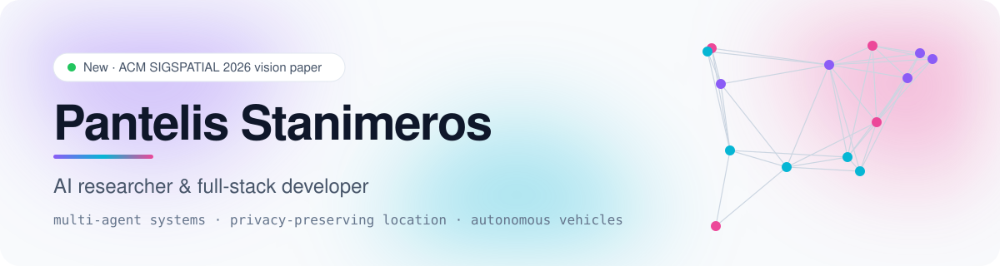
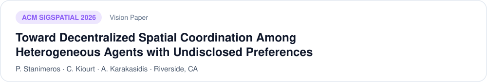
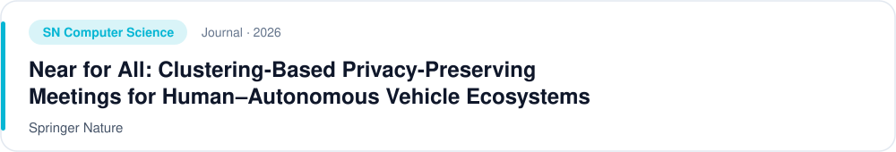
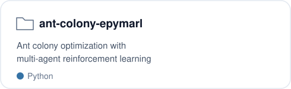
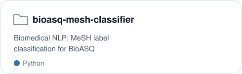
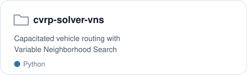
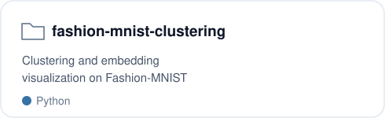

<picture><source media="(prefers-color-scheme: dark)" srcset="assets/banner-dark.svg"></picture>

  
  
  

I work on how autonomous agents, vehicles and people coordinate in space without giving up their privacy, and I ship production web and mobile apps along the way.

## Publications

<a href="https://doi.org/10.1145/3841645.3843410"><picture><source media="(prefers-color-scheme: dark)" srcset="assets/pub-sigspatial-dark.svg"></picture></a>

<a href="https://doi.org/10.1007/s42979-025-04517-w"><picture><source media="(prefers-color-scheme: dark)" srcset="assets/pub-sncs-dark.svg"></picture></a>

<a href="https://doi.org/10.1007/978-3-031-93598-5_11"><picture><source media="(prefers-color-scheme: dark)" srcset="assets/pub-ccis-dark.svg"></picture></a>

## Selected work

<table>
<tr>
<td width="50%"><a href="https://github.com/stanimeros/ant-colony-epymarl"><picture><source media="(prefers-color-scheme: dark)" srcset="assets/proj-ant-colony-dark.svg"></picture></a></td>
<td width="50%"><a href="https://github.com/stanimeros/bioasq-mesh-classifier"><picture><source media="(prefers-color-scheme: dark)" srcset="assets/proj-bioasq-dark.svg"></picture></a></td>
</tr>
<tr>
<td width="50%"><a href="https://github.com/stanimeros/cvrp-solver-using-variable-neighborhood-search-vns"><picture><source media="(prefers-color-scheme: dark)" srcset="assets/proj-cvrp-dark.svg"></picture></a></td>
<td width="50%"><a href="https://github.com/stanimeros/fashion-mnist-clustering-and-visualization"><picture><source media="(prefers-color-scheme: dark)" srcset="assets/proj-fashion-dark.svg"></picture></a></td>
</tr>
</table>

## Stack

